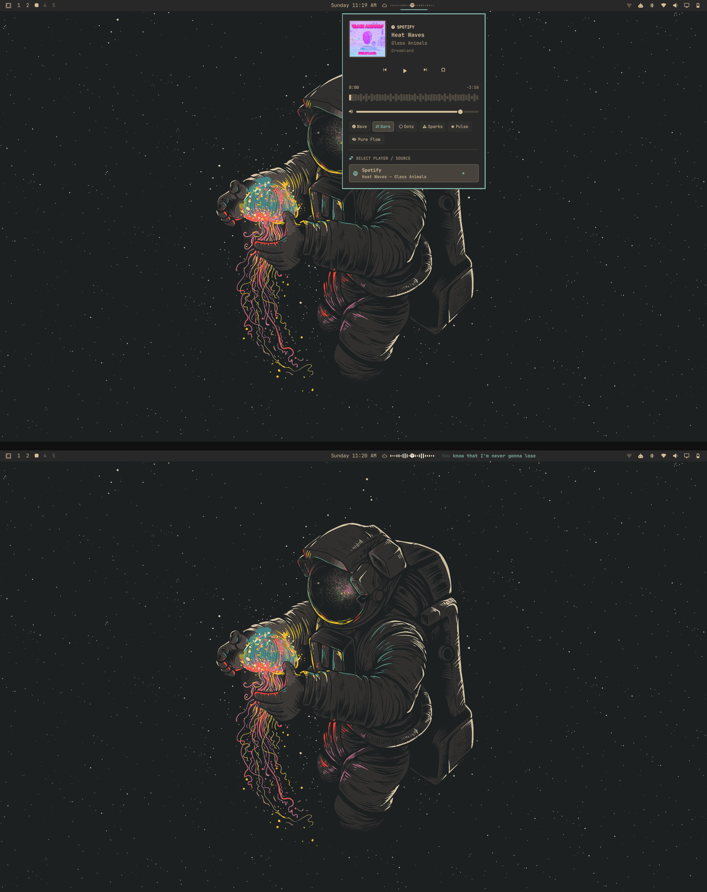

# Music Flow with Synced Lyrics

An Omarchy Quickshell media controller with a live audio visualizer and an independently positionable, time-synced lyrics widget.

This is a community-maintained derivative of [Omarchy Music Flow by Clifford Baidoo](https://github.com/Clifford-Baidoo/omarchy-music-flow). The original MIT license and copyright notice are retained. See [CHANGELOG.md](CHANGELOG.md) for changes in this fork.



### Synced Lyrics


## Features

- Detects MPRIS players and active PipeWire audio, including Spotify, browser media, and MPV.
- Displays track information and an animated sound visualizer in the bar.
- Opens a player panel with source selection, previous/play-pause/next, seeking, and per-app volume controls where PipeWire exposes the stream.
- Adds a separate lyrics widget to the bar. Lyrics are fetched from LRCLIB over HTTPS and synced to the current MPRIS track position when timed lyrics are available.
- Supports clicking the Music Flow bar widget to toggle the lyrics widget.

Spotify controls use the running Spotify player's standard MPRIS controls. They do not require Spotify Premium; Spotify's account and playback restrictions still apply. This plugin does not unlock subscription-only Spotify features.

## Install

### Full setup (media and lyrics widgets)

Requires Omarchy with Quickshell, PipeWire/WirePlumber, Bash, Python 3, and `curl`. Network access to `lrclib.net` is needed to fetch lyrics. No Spotify API key or Spotify subscription is needed for the media controls.

```bash
git clone https://github.com/Rajesh-bandi/music-flow-lyrics.git
cd music-flow-lyrics
./install.sh
```

The installer puts both plugin directories under `~/.config/omarchy/plugins/`, adds both widgets to the bar, and restarts the Omarchy shell. It preserves any previous `custom.media` or `custom.lyrics` directories as timestamped backups. It also enables MPV MPRIS integration if a supported system MPRIS script is present.

### Install from the marketplace CLI

The root manifest lists Music Flow. The companion lyrics widget is bundled in this repository and is installed by `./install.sh` above; a plain `omarchy plugin add` installs only the root plugin. For the complete experience, use the full setup command.

## Use

- Click the Music Flow widget to open its player panel.
- Middle-click the widget to play or pause.
- Scroll over it to move between tracks.
- Use the lyrics button in the player panel to toggle the adjacent synced lyrics widget.
- Move either widget independently with the Omarchy bar controls.

Controls depend on the active player exposing the corresponding MPRIS capability. Lyrics availability and timing depend on LRCLIB having a matching timed entry.

## Update and remove

From the cloned repository:

```bash
./update.sh
```

To remove both widgets and restore Omarchy's stock media widget:

```bash
./uninstall.sh
```

The uninstaller moves plugin directories into timestamped backups instead of deleting them.

## Marketplace submission

The root `manifest.json` is the marketplace listing manifest. Suggested listing metadata:

- **Name:** Music Flow with Synced Lyrics
- **Category:** Widgets
- **Tags:** media, bar, quickshell
- **Repository:** `https://github.com/Rajesh-bandi/music-flow-lyrics`

The marketplace CLI install path provides the root Music Flow plugin. To get both widgets and automatic bar setup, follow the full setup instructions above. Review the current [Omarchy plugin publishing guide](https://plugins.omarchy.org/publish.html) before submitting.

## License

MIT. Original work by Clifford Baidoo; this fork's changes by Rajesh Bandi. See [LICENSE](LICENSE).
