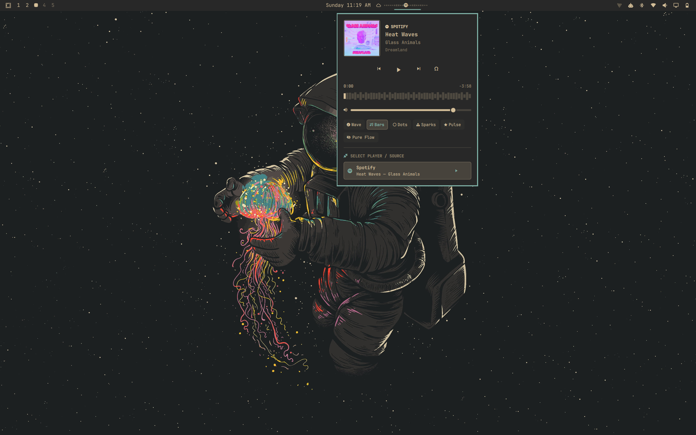
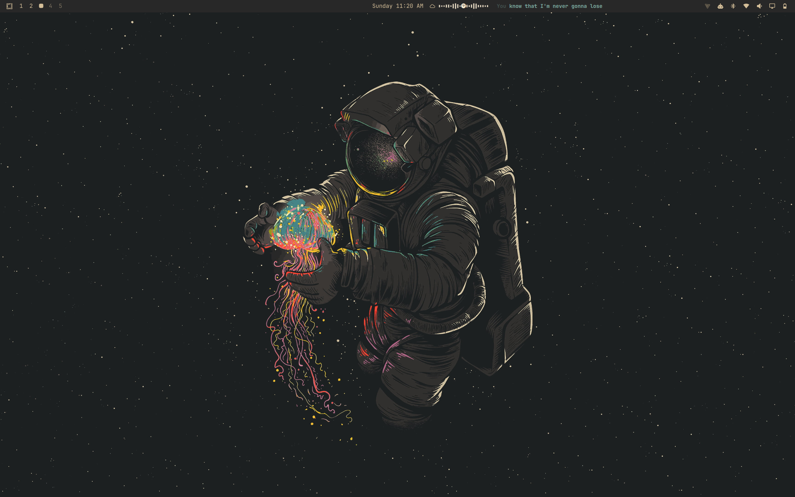

# Music Flow with Synced Lyrics

An Omarchy Quickshell media controller with a live audio visualizer and an optional, time-synced lyrics strip built into the same bar widget.

This is a community-maintained derivative of [Omarchy Music Flow by Clifford Baidoo](https://github.com/Clifford-Baidoo/omarchy-music-flow). The original MIT license and copyright notice are retained. See [CHANGELOG.md](CHANGELOG.md) for changes in this fork.



### Synced Lyrics


## Features

- Detects MPRIS players and active PipeWire audio, including Spotify, browser media, and MPV.
- Displays track information and an animated sound visualizer in the bar.
- Opens a player panel with source selection, previous/play-pause/next, seeking, and per-app volume controls where PipeWire exposes the stream.
- Shows synced lyrics beside the media controller when the lyrics button is enabled. Lyrics are fetched from LRCLIB over HTTPS; timed lyrics follow the current MPRIS position, with plain lyrics available when timed lyrics are not provided.
- The media controls and lyrics ship together in the root plugin, so marketplace installation includes both features.

Spotify controls use the running Spotify player's standard MPRIS controls. They do not require Spotify Premium; Spotify's account and playback restrictions still apply. This plugin does not unlock subscription-only Spotify features.

## Install

### Install from the marketplace

Install **Music Flow with Synced Lyrics** from the Omarchy plugin marketplace. This installs both media controls and the inline lyrics strip as one plugin.

### Install from source

Requires Omarchy with Quickshell, PipeWire/WirePlumber, Bash, Python 3, and `curl`. Network access to `lrclib.net` is needed to fetch lyrics. No Spotify API key or Spotify subscription is needed for the media controls.

```bash
git clone https://github.com/Rajesh-bandi/music-flow-lyrics.git
cd music-flow-lyrics
./install.sh
```

The installer puts the single plugin under `~/.config/omarchy/plugins/`, adds it to the bar, and restarts the Omarchy shell. It preserves previous `custom.media` and `custom.lyrics` directories as timestamped backups. It also enables MPV MPRIS integration if a supported system MPRIS script is present.

## Use

- Click the Music Flow widget to open its player panel.
- Middle-click the widget to play or pause.
- Scroll over it to move between tracks.
- Use the lyrics button in the player panel to show or hide the synced lyrics strip beside Music Flow.
- Move Music Flow, including its lyrics strip, with the Omarchy bar controls.

Controls depend on the active player exposing the corresponding MPRIS capability. Lyrics availability and timing depend on LRCLIB having a matching timed entry.

## Update and remove

From the cloned repository:

```bash
./update.sh
```

To remove the plugin and restore Omarchy's stock media widget:

```bash
./uninstall.sh
```

The uninstaller moves plugin directories into timestamped backups instead of deleting them.

## Marketplace submission

The root `manifest.json` is the marketplace listing manifest. Suggested listing metadata:

- **Name:** Music Flow with Synced Lyrics
- **Category:** Widgets
- **Tags:** media, bar, quickshell
- **Repository:** `https://github.com/Rajesh-bandi/music-flow-lyrics`

The root manifest contains both media controls and the inline lyrics strip. The source installer additionally automates bar setup. Review the current [Omarchy plugin publishing guide](https://plugins.omarchy.org/publish.html) before submitting.

## License

MIT. Original work by Clifford Baidoo; this fork's changes by Rajesh Bandi. See [LICENSE](LICENSE).
